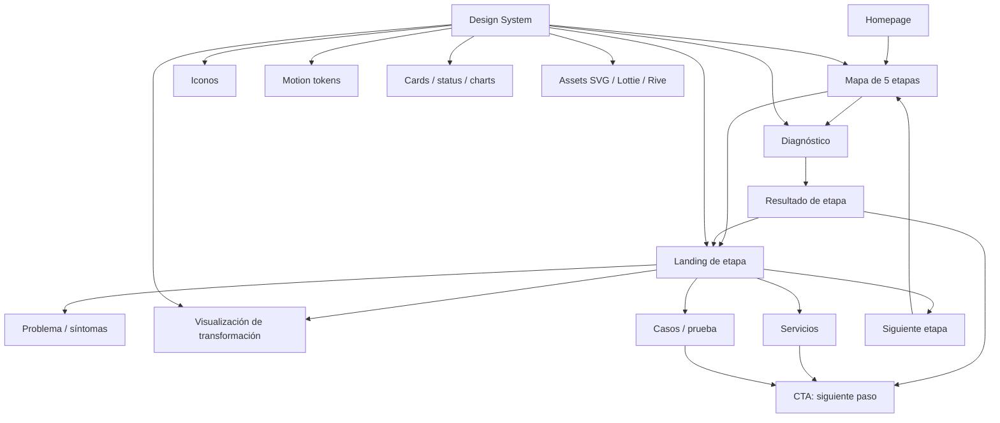
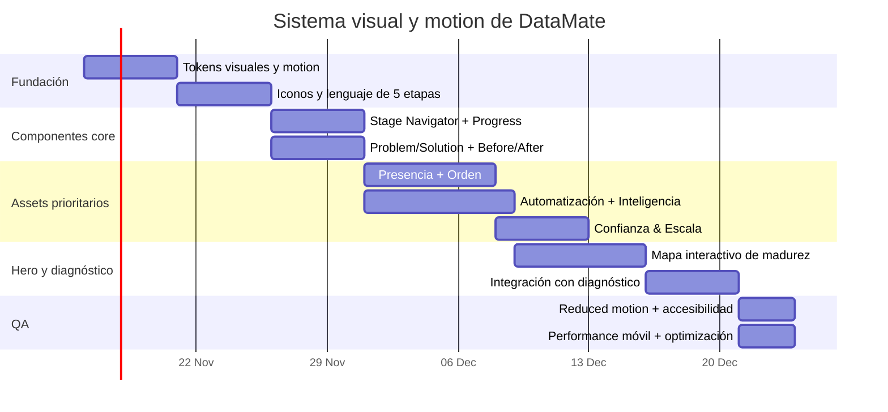

# DataMate.cl — investigación comparativa de UX, etapas, animación y sistema de assets

## Resumen ejecutivo

La principal conclusión es que **DataMate tiene una oportunidad de diferenciación más fuerte en la arquitectura “diagnóstico → etapa → siguiente paso” que en una presentación tradicional de servicios**. El material estratégico suministrado define cinco etapas —Presencia, Orden, Automatización, Inteligencia y Confianza & Escala— y plantea explícitamente que el sitio debe ayudar a una pyme a reconocer su problema, identificar su etapa y avanzar hacia una solución concreta.

Sin embargo, **esa arquitectura todavía no está reflejada de forma clara en el sitio público actualmente indexado**. Google/Web todavía devuelve la home como “DataMate | DataRobot en Latam”, y la versión rastreable expone una navegación extremadamente reducida: Home, Nosotros y un Blog que apunta a Perplexity. Esto crea una brecha importante entre la estrategia futura y la entidad que hoy perciben buscadores y usuarios.

La mejor referencia para el concepto de “etapas” no es una agencia tradicional sino **Chequeo Digital / Digitaliza tu Pyme**, porque convierte la madurez digital en una experiencia tangible: diagnóstico, nivel, recomendaciones y seguimiento. El BID describe un cuestionario de 62 preguntas, ocho dimensiones, cinco estados de madurez y recomendaciones personalizadas; además, el instrumento puede repetirse para observar progreso.

i

Para el lenguaje visual, DataMate debería combinar tres familias de referencia: **claridad diagnóstica** de Chequeo Digital, **visualización operativa** de Odoo/Zapier/n8n y **autoridad consultiva** de Baufest/Nisum/Thoughtworks. Baufest, por ejemplo, organiza capacidades de punta a punta en Diseñar, Construir y Operar; Nisum comunica cinco áreas de trabajo y un modelo propio; Thoughtworks conecta “AI maturity” con roadmap y producción; y Zapier/n8n hacen visible la lógica de automatización mediante flujos, nodos y acciones.

La recomendación es **no producir cinco universos gráficos independientes**. Debe existir un único lenguaje sistémico con: un color/acento por etapa, una metáfora principal, un set de iconos, un componente de progreso, un componente “antes/después”, un patrón de microinteracción y un conjunto de motion tokens compartidos. Para movimiento, conviene apoyarse en SVG/CSS y Lottie para piezas sencillas, y reservar Rive para uno o dos momentos de alto valor —por ejemplo, el hero y el mapa interactivo de madurez—. Rive permite state machines, interacción con hover/click/scroll y gráficos vectoriales reutilizables; Material 3 recomienda distinguir motion “expressive” para momentos clave y “standard” para interacciones utilitarias.

La accesibilidad debe entrar desde el sistema de diseño, no como parche. W3C recomienda que las animaciones no esenciales activadas por interacción puedan deshabilitarse y documenta `prefers-reduced-motion` como técnica válida; MDN también recomienda reducir o sustituir movimiento cuando el usuario lo solicita.

**Supuestos usados:** no se especificaron stack, presupuesto, framework, límites de peso de assets ni identidad visual final; por ello asumo web moderna responsive, CMS o framework compatible con SVG/Lottie/Rive, español como idioma principal, performance móvil como restricción importante y accesibilidad WCAG 2.2 AA como objetivo general, usando la recomendación de reducción de movimiento de WCAG 2.3.3 como práctica adicional.

## Estado actual y mapa recomendado de etapas

### Lo que existe hoy

La versión pública rastreable de datamate.cl todavía presenta señales fuertes de posicionamiento legado: el título indexado menciona DataRobot y la estructura rastreable no permite descubrir una arquitectura de cinco etapas.

Esto significa que, para diseño, hay que separar dos cosas:

| Capa | Situación |
|---|---|
| Sitio público actual | Arquitectura mínima y semántica heredada alrededor de DataRobot. |
| Dirección estratégica | Cinco etapas centradas en problemas de la pyme y en “qué viene después”. |
| Implicación UX | La reconstrucción debería tratar las etapas como **mecanismo de navegación y diagnóstico**, no solo como secciones de marketing. |
| Implicación visual | Cada etapa necesita una señal visual inequívoca, pero dentro de un mismo sistema. |
| Implicación de conversión | Cada etapa debe terminar en diagnóstico, solución sugerida y CTA, no en una descripción abierta de capacidades. |

### Arquitectura de las cinco etapas

| Etapa | Problema expresado por el cliente | Contenido principal | Patrón UX recomendado | Metáfora visual |
|---|---|---|---|---|
| **Presencia** | “No me encuentran.” | Web, landing pages, SEO, GEO. | Descubrimiento → visibilidad → captura | Señal / radar / escaparate |
| **Orden** | “Todo está en Excel y WhatsApp.” | ERP, CRM, sistemas a medida, procesos. | Caos → estructura → flujo operativo | Piezas dispersas que se organizan |
| **Automatización** | “Mi equipo no da abasto.” | Automatización, agentes IA, agentes a medida, Soul en validación. | Trabajo manual → trigger → ejecución automática | Nodos / flujo / agentes |
| **Inteligencia** | “Tengo datos y no los uso.” | Datos, analítica, BI e inteligencia asistida por IA. | Datos → patrón → insight → decisión | Señales que convergen en decisión |
| **Confianza & Escala** | “Me piden seguridad / mi equipo no sabe usar IA.” | Formación, readiness ISO 27001, ciberseguridad, gobernanza. | Riesgo → controles → evidencia → expansión | Escudo / capas / red confiable |

El patrón debería ser constante en las cinco páginas: **síntoma → qué significa → señales de que estás aquí → qué desbloquea esta etapa → servicios → prueba → próximo nivel → CTA**. Es una adaptación comercial del modelo utilizado por Chequeo Digital, donde la evaluación conduce a un nivel de madurez y a recomendaciones concretas.

El mapa de madurez no debería tratar las etapas como una jerarquía moral. Una empresa puede tener buena presencia y baja madurez de datos, o una automatización puntual sin procesos ordenados. El BID evalúa múltiples dimensiones precisamente porque la madurez no es estrictamente lineal; por tanto, para DataMate la escalera debe presentarse como **“siguiente capa útil”**, no como una certificación absoluta de sofisticación.

## Referentes y competidores comparables

Los siguientes sitios son útiles no porque todos compitan directamente por una pyme panameña o chilena, sino porque resuelven partes distintas del problema de DataMate: diagnóstico, consultoría end-to-end, sistemas operativos empresariales, automatización e IA.

| Sitio | URL | Modelo de etapas / arquitectura | Lenguaje visual | Uso de animación / interacción | Qué tomar / qué evitar |
|---|---|---|---|---|---|
| **Chequeo Digital / Digitaliza tu Pyme** | https://www.digitalizatupyme.cl/ | Evaluación → nivel de madurez → recomendaciones; el modelo BID utiliza múltiples dimensiones y cinco niveles. | Azul institucional, ilustración simple, dashboards y señales de progreso. | Relativamente funcional; la experiencia se apoya más en evaluación y resultado que en espectáculo visual. | **Tomar:** progresión, scoring y claridad. **Evitar:** duración de 25 min como primera interacción comercial. |
| **Baufest** | https://www.baufest.com/es | “Diseñar → Construir → Operar”; las capacidades cubren estrategia, productos/plataformas y operaciones. | Corporativo contemporáneo, fotografías/casos, módulos grandes y autoridad de clientes. | Motion contenido; jerarquía por scroll y elementos visuales más que interacción gamificada. | **Tomar:** organización end-to-end y prueba. **Evitar:** amplitud que puede sentirse enterprise para una pyme. |
| **Nisum** | https://www.nisum.com/es/inicio | Combina cuatro resultados de negocio y cinco capacidades principales; comunica acompañamiento desde estrategia hasta implementación. | Hero tipo slider, métricas, logos, tarjetas y casos de impacto. | Uso medio de sliders/carousels y revelado progresivo. | **Tomar:** pruebas cuantificadas y estructura modular. **Evitar:** demasiadas taxonomías simultáneas. |
| **Thoughtworks** | https://www.thoughtworks.com/what-we-do/enterprise-ai | Madurez/estrategia → agentes → AI Factory → modernización de datos; explícitamente invita a evaluar “AI readiness”. | Editorial, técnica, sobria; mucha prueba, research y casos. | Motion secundario; el contenido y los módulos de producto dominan. | **Tomar:** autoridad y roadmap. **Evitar:** densidad de lenguaje enterprise. |
| **Globant** | https://www.globant.com/our-services | No usa una escalera de madurez; agrupa servicios en grandes dominios como Digital Evolution y Enterprise. | Tipografía muy grande, lenguaje editorial, composiciones atrevidas y brand moments. | Uso más expresivo y de alto impacto; la propia página presenta momentos “WATCH”. | **Tomar:** confianza visual y heroes memorables. **Evitar:** espectáculo que opaque el diagnóstico. |
| **Zapier** | https://zapier.com/ | Construir → ejecutar → gobernar; sus workflows funcionan mediante triggers y acciones. | Diagramas de producto, logos de apps y flujos visuales. | Alto valor demostrativo: el producto se explica mostrando automatizaciones y pasos. | **Tomar:** representar trabajo real, no “IA abstracta”. |
| **Odoo** | https://www.odoo.com/ | No presenta madurez; vende una plataforma que consolida procesos mediante apps empresariales. | Interfaces de producto, iconos de apps y alta densidad funcional. | Interacción basada en producto y demos, no narrativa cinematográfica. | **Tomar:** visualización concreta de “orden”. **Evitar:** catálogo excesivo de módulos. |
| **n8n** | https://n8n.io/ | Construir → entender → ejecutar workflows/agentes, con pasos visibles y control humano. | Nodos, conectores, canvas técnico, mensajes de confianza/control. | Muy alto valor visual: el flujo mismo es el lenguaje de la marca. | **Tomar:** conexiones animadas y estados. **Evitar:** estética demasiado developer-first para pymes no técnicas. |

La gran diferencia respecto de estos referentes es que **DataMate puede convertir servicios heterogéneos en una sola narrativa coherente**. Baufest, Globant y Nisum se organizan por capacidades; Odoo por aplicaciones; Zapier/n8n por workflows; Chequeo Digital por madurez. DataMate puede unir los cuatro conceptos: *“diagnostico tu problema → identifico etapa → muestro cómo cambia tu operación → implemento el siguiente nivel”*. Esa combinación es mucho más defendible que copiar un hero “AI-first”.

## Biblioteca de assets por etapa

La propuesta siguiente utiliza un sistema común. Los formatos se seleccionan por función: **SVG/CSS** para iconos y microinteracciones ligeras; **Lottie** para secuencias lineales reutilizables; **Rive** para interacción con estados; **WebP/AVIF** para fotografía; y HTML/CSS nativo para dashboards y diagramas que deban ser accesibles o alimentados por datos. Rive soporta state machines, listeners, inputs y runtimes web, mientras que LottieFiles ofrece análisis específico de accesibilidad para `.lottie` y `.json`.

### Presencia

| Concepto | Descripción y propósito | Formato / complejidad | Accesibilidad | Adaptación al sistema |
|---|---|---|---|---|
| **Radar de descubrimiento** | Un negocio aparece gradualmente en Google, mapas y asistentes IA. Explica “ser encontrado”. | SVG + CSS, **media** | Reducir barrido continuo; fallback estático. | `stage-presence-accent`, componente `DiscoveryRadar`, motion `scan-slow`. |
| **SERP before/after** | Resultado sin optimizar vs. resultado enriquecido. Convierte SEO/GEO en algo visible. | HTML + SVG, **baja** | Todo el contenido debe existir como texto real. | `SearchResultCard`, tokens de elevación y estado. |
| **Mapa de señales** | Web, ficha local, reviews, contenido y AI citation convergen en la marca. | Rive, **alta** | En reduced-motion mostrar diagrama final. | `SignalMap`, inputs de hover por canal. |
| **Hero “se enciende la presencia”** | Fachada o storefront digital que pasa de oscuro a visible. | Lottie/SVG, **media** | Sin flashes; transición por opacidad. | Motion hero reutilizable; duración 700–1000 ms. |
| **Microinteracción de indexación** | Check de “indexado”, “mobile”, “schema”, “AI-readable”. | SVG animated icons, **baja** | Iconos con etiquetas visibles. | `StatusChip` + `IconMotion`. |
| **Constelación de canales** | Website, Google, ChatGPT, redes y mapas unidos alrededor de la empresa. | SVG/Rive, **media** | No depender solo del color para distinguir canales. | Componente `ChannelOrbit`, máximo 5 nodos. |
| **Foto de negocio real + overlay digital** | Pymes reales con capas discretas de datos/UI. Evita clichés de “robot azul”. | AVIF/WebP + SVG, **media** | Texto fuera de la imagen; alt descriptivo. | Preset fotográfico y overlay tokenizado. |
| **Progress reveal “de invisible a encontrable”** | Scroll corto que añade señales de visibilidad una por una. | CSS/Intersection Observer, **media** | Reduced motion = aparición instantánea. | `StageStoryReveal`; una sola dirección de movimiento. |

Referencia útil: el hero de Digitaliza tu Pyme utiliza ilustración funcional y una propuesta inmediata de “conoce tu nivel”, un patrón apropiado para convertir un concepto abstracto en una acción.

### Orden

| Concepto | Descripción y propósito | Formato / complejidad | Accesibilidad | Adaptación al sistema |
|---|---|---|---|---|
| **Excel + WhatsApp → sistema único** | Celdas, chats y documentos dispersos se agrupan en CRM/ERP. | Rive, **alta** | Fallback final con flechas y etiquetas. | `ChaosToSystem`, states `messy/organizing/ordered`. |
| **Flujo operativo lineal** | Lead → venta → factura → inventario → seguimiento. | SVG + CSS, **media** | Paso activo con texto y número, no solo color. | `ProcessStepper`, tokens por estado. |
| **Inbox que se ordena** | Mensajes dispersos se convierten en tareas o tickets. | Lottie, **media** | Pausable; no autoplay infinito. | `InboxTransformation`. |
| **Dashboard “single source of truth”** | Tarjetas que consolidan clientes, ventas y operaciones. | HTML/CSS, **media** | Tabla/valores accesibles al lector de pantalla. | `MetricCard`, `MiniChart`, `DataStatus`. |
| **Microinteracción de deduplicación** | Dos fichas de cliente se fusionan en una. | SVG, **baja** | Anuncio textual del resultado. | `MergeRecordIcon`. |
| **Timeline de proceso** | Antes: cinco herramientas; después: un flujo. | HTML/SVG, **baja** | Orden DOM igual al orden visual. | `BeforeAfterTimeline`. |
| **Módulos encajables** | CRM, ERP, facturación, inventario como piezas conectables. | Rive/SVG, **media** | Reduced motion muestra ensamblaje final. | `BusinessModules`, grid común a servicios. |
| **Fotografía “trabajo real”** | Personas usando terminales, inventario o atención, con interfaz en contexto. | AVIF/WebP, **baja** | Evitar texto embebido en foto. | Guía fotográfica: contexto > stock tecnológico. |

Odoo es una referencia especialmente útil aquí porque comunica orden mostrando aplicaciones concretas —CRM, inventario, ventas, proyectos, contabilidad— en vez de describir “transformación” en abstracto.

### Automatización

| Concepto | Descripción y propósito | Formato / complejidad | Accesibilidad | Adaptación al sistema |
|---|---|---|---|---|
| **Workflow vivo** | Trigger → decisión → acción → resultado. | Rive, **alta** | Controles play/pause y resumen textual. | `WorkflowGraph`; nodos y edges tokenizados. |
| **Pulso que atraviesa nodos** | Señal visual de que un proceso está ejecutándose. | SVG/CSS, **baja** | Desactivar desplazamiento continuo con reduced motion. | `FlowEdgeActive`. |
| **Human-in-the-loop** | El flujo se detiene en aprobación humana y continúa. | Rive, **media** | Botón de aprobación real y foco visible. | Estado `waiting/approved/rejected`. |
| **Agente ejecutando tareas** | Tarjetas de email, CRM, agenda y documento se completan secuencialmente. | Lottie/Rive, **alta** | No más de una zona animada a la vez. | `AgentTaskStack`. |
| **Horas recuperadas** | Bloques repetitivos desaparecen del calendario y se liberan. | SVG, **media** | Valor numérico visible independientemente de la animación. | `TimeRecovered`. |
| **Automatización WhatsApp** | Mensaje → clasificación → CRM → respuesta → asignación. | SVG/Rive, **media** | No simular conversación únicamente con movimiento. | `MessagingWorkflow`. |
| **“Manual vs automático” slider** | Usuario arrastra para comparar operación manual y automática. | HTML/CSS/JS, **media** | Alternativa de botones Antes/Después para teclado. | `CompareSlider`. |
| **Plantillas de workflow** | Cards con “lead routing”, “factura”, “onboarding”, “hotel”. | HTML + SVG, **baja** | Cards accesibles y orden de lectura simple. | `WorkflowTemplateCard`. |

Zapier basa su narrativa actual en construir, ejecutar y gobernar workflows, mientras n8n enfatiza pasos visibles, aprobaciones humanas y capacidad de inspeccionar cada acción; ambos son mejores referencias para DataMate que una animación genérica de “cerebro IA”.

### Inteligencia

| Concepto | Descripción y propósito | Formato / complejidad | Accesibilidad | Adaptación al sistema |
|---|---|---|---|---|
| **Datos → insight** | Puntos dispersos se agrupan y generan una recomendación. | SVG/Rive, **media** | Insight final debe existir como texto. | `InsightReveal`, token `intelligence-accent`. |
| **Chart morph** | Tabla → barras → insight destacado. | SVG/HTML, **media** | Tabla de datos alternativa. | `ChartTransition`, escalas tipográficas/data tokens. |
| **Pregunta ejecutiva → respuesta** | “¿Qué producto está cayendo?” y dashboard ilumina la causa. | HTML/Rive, **alta** | Resultado textual y foco manejable. | `AskYourData`. |
| **Semáforo de decisiones** | Indicadores cambian entre observar, actuar y priorizar. | SVG, **baja** | Icono + etiqueta + color. | `DecisionStatus`. |
| **Anomaly pulse** | Una serie identifica un punto anómalo y explica por qué importa. | SVG, **media** | Sin pulsación constante; máximo 2–3 ciclos. | `AnomalyMarker`. |
| **Narrativa “dato crudo → contexto → acción”** | Tres capas progresivas. | CSS + SVG, **baja** | Secuencia lineal disponible sin scroll animation. | `DataToActionStepper`. |
| **Mini-dashboard realista** | Visualización con métricas coherentes con casos reales. | HTML/CSS, **media** | Contraste y valores accesibles. | `DataCard` + `ChartPrimitive`. |
| **Fotografía + data annotation** | Equipo en una reunión con anotaciones de indicadores, no hologramas. | AVIF + SVG, **media** | Overlays decorativos fuera del texto principal. | Preset “decision context”. |

Thoughtworks es un buen referente de narrativa porque conecta directamente datos confiables, modernización y capacidad de ejecutar IA en producción, evitando tratar analytics como una galería aislada de gráficos.

### Confianza & Escala

| Concepto | Descripción y propósito | Formato / complejidad | Accesibilidad | Adaptación al sistema |
|---|---|---|---|---|
| **Capas de confianza** | Personas → procesos → datos → controles → auditoría/readiness. | SVG/Rive, **media** | Capas numeradas y etiquetadas. | `TrustLayers`. |
| **Escudo construido por controles** | El escudo aparece al completar políticas, accesos, backup, formación. | Lottie, **media** | Evitar implicar “certificación conseguida”. | `ReadinessShield`, estados semánticos. |
| **Checklist readiness** | Controles se marcan progresivamente durante un diagnóstico. | HTML/SVG, **baja** | Checkbox visual no debe confundirse con checkbox real. | `ReadinessChecklist`. |
| **Mapa de permisos** | Usuario → rol → sistema → dato; comunica gobernanza. | SVG/Rive, **alta** | Equivalente textual del grafo. | `AccessGraph`. |
| **Microinteracción “verified”** | Badge de práctica o evidencia verificada. | SVG, **baja** | Tooltip accesible explicando qué se verificó. | `EvidenceBadge`; nunca usar como “certificado” sin evidencia. |
| **Training progress** | Módulos de capacitación completados por equipo. | HTML/SVG, **baja** | Progress semántico con `aria-valuenow`. | `LearningProgress`. |
| **Risk → control** | Tarjetas de riesgo se conectan con medidas concretas. | CSS/SVG, **media** | Relaciones explícitas en texto. | `RiskControlPair`. |
| **Escala segura** | Red de sucursales/clientes crece después de estabilizar controles. | Rive, **alta** | Reduced motion = diagrama estático final. | `SafeScaleMap`. |

La narrativa debe ser estricta: **readiness/preparación ≠ certificación**. El propio documento estratégico advierte que DataMate no debe presentarse como entidad certificadora ISO 27001 sin verificación independiente.

### Reglas del sistema de motion

La biblioteca debería exponer solo unos pocos tokens, no timings arbitrarios por componente:

| Token | Uso sugerido |
|---|---|
| `motion.instant` | 80–120 ms — feedback inmediato |
| `motion.fast` | 160–220 ms — hover, chip, icono |
| `motion.standard` | 280–360 ms — cambios de estado |
| `motion.expressive` | 500–800 ms — transición de etapa |
| `motion.hero` | 800–1200 ms — narrativa principal |
| `motion.loop` | Solo procesos explicativos; nunca decoración infinita dominante |
| `motion.reduced` | Sin traslación/zoom; usar opacity/cambio instantáneo |

Material 3 separa motion expresivo de motion funcional, una distinción muy útil para DataMate: el hero y el mapa de etapas pueden ser “expressive”; formularios, botones, tarjetas y estados de diagnóstico deberían ser “standard”.

W3C recomienda evitar movimiento innecesario y respetar la preferencia de reducción de movimiento; `prefers-reduced-motion` debe formar parte de la definición del componente, no depender de una revisión posterior.

Referencias técnicas primarias para el sistema:

- Rive para heroes interactivos y state machines: https://rive.app/use-cases/websites y https://rive.app/features
- Material Design Motion: https://m3.material.io/styles/motion
- WCAG Animation from Interactions: https://www.w3.org/WAI/WCAG22/Understanding/animation-from-interactions
- Técnica `prefers-reduced-motion`: https://www.w3.org/WAI/WCAG22/Techniques/css/C39.html
- Lottie Accessibility Analyzer: https://help.lottie.com/hc/en-us/articles/43259873084569-Lottie-Accessibility-Analyzer

## Prioridades de implementación

Las estimaciones siguientes son **estimaciones de diseño + front-end**, no cotizaciones. Asumo que existe una base web ya operativa, un diseñador de producto/brand y un desarrollador front-end; no incluyen investigación de contenido, backend del diagnóstico ni producción fotográfica compleja.

| Prioridad | Asset / componente | Etapa | Esfuerzo estimado | Impacto | Razón |
|---|---|---|---:|---|---|
| **P0** | Navegador visual de 5 etapas | Global | 3–5 días | Muy alto | Convierte la estrategia en arquitectura visible. |
| **P0** | Sistema de iconos de etapas | Global | 2–3 días | Alto | Hace reconocible cada etapa en todo el sitio. |
| **P0** | `StageProgress / Next Step` | Global | 1–2 días | Muy alto | Refuerza la idea central “qué viene después”. |
| **P0** | Componente problema → solución | Todas | 2 días | Muy alto | Traduce lenguaje de cliente a servicio. |
| **P1** | Hero interactivo “mapa de madurez” | Home | 5–8 días | Muy alto | Puede convertirse en la pieza distintiva del sitio. |
| **P1** | Chaos → System | Orden | 4–6 días | Alto | Visualiza uno de los pains más concretos: Excel/WhatsApp. |
| **P1** | Workflow animado | Automatización | 4–6 días | Muy alto | Demuestra valor de IA sin clichés. |
| **P1** | Data → Insight | Inteligencia | 3–5 días | Alto | Simplifica la propuesta de BI/analytics. |
| **P1** | Trust Layers | Confianza & Escala | 3–5 días | Alto | Explica readiness sin sobreprometer certificación. |
| **P1** | SERP / discovery component | Presencia | 2–3 días | Alto | Hace SEO/GEO comprensible a una pyme. |
| **P2** | Antes/después reutilizable | Todas | 2–4 días | Alto | Sirve para casos, soluciones y resultados. |
| **P2** | Biblioteca de microinteracciones | Global | 3–5 días | Medio-alto | Eleva percepción de calidad con bajo peso. |
| **P2** | Set de mini-dashboards | Orden/Inteligencia | 4–6 días | Medio | Reutilizable en landing pages y casos. |
| **P3** | Fotografía original por etapa | Todas | 5–10 días producción | Alto | Sustituye stock tecnológico genérico. |
| **P3** | Segundo nivel de Rive interactivo | Varias | 5–10 días | Medio | Útil solo después de validar el lenguaje principal. |

El orden P0/P1 prioriza **claridad antes que espectáculo**. Es coherente con el BID, donde la utilidad del diagnóstico y las recomendaciones constituye el valor principal, y con Zapier/n8n, donde el movimiento explica procesos reales.

## Arquitectura de componentes y cronograma

### Relación entre componentes

La relación clave es que **“etapa” no sea una ilustración aislada**, sino una propiedad transversal de componentes. `StageCard`, `StageBadge`, `StageProgress`, `ProblemCard`, `ServiceCard`, `DiagnosticResult`, `NextStepCTA`, `CaseStudyCard` y los assets animados deben compartir los mismos tokens.

### Cronograma recomendado

El plan equivale aproximadamente a **seis semanas de trabajo secuencial**, aunque varias tareas pueden solaparse si diseño y desarrollo trabajan en paralelo. La prioridad no debería ser “animar todas las páginas”; debería ser crear primero el lenguaje, los tokens y cinco o seis assets que demuestren que DataMate entiende el problema del cliente.

La regla final para el sistema sería: **cada animación debe explicar un cambio de negocio**. Presencia hace visible; Orden organiza; Automatización ejecuta; Inteligencia interpreta; Confianza protege y permite crecer. Si una animación no ayuda a comprender uno de esos cambios, probablemente es decoración y no merece el coste de performance, mantenimiento ni accesibilidad. Esa dirección también mantiene la narrativa estratégica original: capturar el problema, diagnosticar la etapa, recomendar el siguiente paso y convertirlo en una implementación concreta.